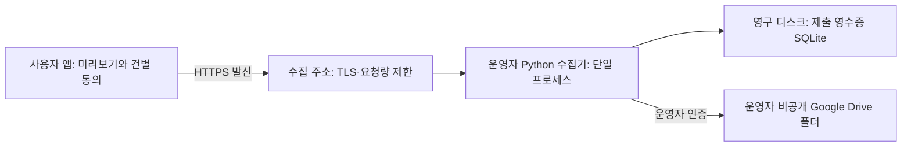

# 리포트 데이터 제출 서버 준비 계획

> **2026-10-18 후속 변경:** 서버·Google Drive 자동 제출은 제거하고 JSON 저장 후 이메일 수동 첨부로 전환했다. 새 내보내기에는 VOD 번호가 포함된다. 아래 내용은 당시 기록이며 현재 동작은 [이메일 리포트 변경 기록](2026-10-18-리포트-이메일안내-VOD번호-개선.md)을 따른다.

작성일: 2026-10-18
상태: **준비 계획. 서버 배포·Google 인증·실제 전송·앱 빌드는 하지 않음.**

## 1. 목표와 현재 상태

사용자가 전송 내용을 확인하고 건별로 동의한 성능 리포트를 운영자 서버에서 받아, 운영자의 비공개 Google Drive에 저장한다. 일반 이용자는 Google 로그인이나 서버 설치를 하지 않는다. 사용자 PC의 외부 수신 포트도 열지 않는다.

| 항목 | 현재 상태 | 서비스 전에 할 일 |
|---|---|---|
| 앱 리포트·제출 미리보기·건별 동의 | 소스 구현됨 | 실제 HTTPS 수집 서버와 연결 확인 |
| 제출 데이터 형식 검사 | 앱/서버 공통 허용 목록, 최대 128 KiB | 잘못된 요청·구버전 호환·외부 요청 검증 |
| 수집 서버 | `report_collector/server.py` 준비 | 운영 실행 설정, 제한·장애 대응 보완 |
| Google Drive 저장 | OAuth 갱신·JSON 업로드·중복 대조 코드 있음 | 운영자 계정 인증, 폴더 권한, 실제 저장 확인 |
| 중복 제출 기록 | SQLite 영수증 + Drive 속성 대조 | 영구 디스크·동시 실행·응답 유실 검증 |
| 보관 만료 삭제 | 삭제 명령 있음 | 중간 실패 복구 보완, 주기 실행·알림 설정 |
| 서버·주소·인증서 | 미준비 | 호스팅 선택, HTTPS 주소 확보 |
| 운영자·연락처·보관 안내 | 미확정 | 공개 안내문과 앱 표시 확정 |
| 외부 제출 검증 | 미실시 | 시험 서버에서 합성 데이터로 확인 |

기존 구현 문서의 76개 검사는 당시 로컬·모의 검증 기록이다. 실제 서버 운영 검증을 통과했다는 뜻이 아니며 이번 문서 작성에서 재실행하지 않았다.

## 2. 권장 구성

- 초기 구성은 **상시 실행 Python 서비스 1개 + 영구 디스크 + HTTPS 진입점**으로 잡는다. 기존 코드의 SQLite·프로세스 잠금·메모리 요청 제한을 유지하기 위한 선택이다.
- VPS 또는 이 조건을 지원하는 호스팅을 선택한다. 서버리스나 자동으로 여러 인스턴스를 띄우는 환경에 현재 코드를 그대로 올리지 않는다. 그런 환경은 공유 DB·분산 중복 방지 설계가 먼저 필요하다.
- 서버에서는 추론을 하지 않는다. GPU·LLM 모델·영상 저장 공간은 필요하지 않다. 요금·사양은 호스팅 선택과 시험 부하 결과를 보고 확정한다.
- 사용자에게 공개하는 것은 운영자 서버의 HTTPS 수집 주소다. 사용자 앱의 기존 `127.0.0.1` GUI와 보안 검사는 유지한다. 사용자에게 포트 포워딩·방화벽 예외·터널 설정을 요구하지 않는다.
- 운영 수집기는 로컬/비공개 네트워크에서만 듣고 HTTPS 앞단을 거치게 한다. 개발용 `wsgiref`를 인터넷에 직접 노출하지 않는다. 운영 서버 관리 접속은 별도 제한한다.
- 일반 이용자가 볼 수 있는 리포트 조회 목록·Drive 공유 링크는 만들지 않는다. 데이터 분석 대시보드는 이번 준비 범위 밖이다.

## 3. 단계별 준비 작업

| 순서 | 준비 작업 | 완료 기준 |
|---|---|---|
| 1 | 호스팅·HTTPS 주소·월 비용 상한·운영 담당 결정 | 영구 디스크와 비밀 설정을 지원하는 실행 환경 확보 |
| 2 | 운영자명·문의처·수집 목적·항목·보관기간·삭제 요청 방법 작성 | 공개 안내 페이지와 앱에 같은 내용 표시 |
| 3 | 운영용 Google Cloud 프로젝트와 Drive API 설정 | 전용 OAuth 앱·운영자 인증·비공개 저장 폴더 준비 |
| 4 | 아래 운영 전 보완 사항 구현 | 대기시간·중복·제한·삭제 실패를 구분해 처리 |
| 5 | 시험 서버 배포 | HTTPS·인증·합성 리포트 저장/삭제·장애 복구 검증 |
| 6 | 앱 연결과 macOS/Windows 확인 | 동의한 사본만 제출, 실패해도 분석 정상 이용 |
| 7 | 소규모 운영 시작 | 수집량·오류·보관 만료 삭제 관찰 후 일반 공개 판단 |

계정·비용·정책 결정과 Google 최초 인증은 운영자가 준비한다. 배포 설정·수집기 보완·검증 절차는 이후 작업으로 진행한다. 현재 연결된 Google Drive MCP의 인증을 제품 서버에 복사하거나 재사용하지 않는다.

### Google Drive 준비

1. 운영자 소유 Google Cloud 프로젝트에서 Drive API를 활성화하고 OAuth 동의 화면과 클라이언트를 준비한다.
2. 운영자만 인증하도록 설정한다. 앱 일반 이용자는 이 인증 절차를 거치지 않는다.
3. 권한은 `drive.file`을 우선 사용한다. 이 권한은 해당 앱이 생성하거나 사용자에게 접근 허용받은 파일을 대상으로 하므로, 같은 OAuth 앱으로 전용 폴더를 생성하는 준비 절차를 권장한다. 기존 Drive 폴더 ID만 입력하면 접근된다고 가정하지 않는다. [Google Drive 권한 범위](https://developers.google.com/workspace/drive/api/guides/api-specific-auth)
4. 시험용과 운영용 폴더·영수증 DB·설정을 분리한다. 폴더는 링크 공유를 끄고 운영자만 접근하도록 확인한다. 현재 코드는 공유 권한을 자동 검사하지 않는다.
5. 최초 승인 때 오프라인 접근을 요청해 갱신 토큰을 확보하고 서버 비밀 저장소에만 보관한다. 승인 취소·토큰 만료 때 운영자에게 재인증을 안내하는 절차도 마련한다. [Google 오프라인 인증](https://developers.google.com/identity/protocols/oauth2/web-server#offline)
6. 외부 사용자 유형의 OAuth 앱을 `Testing` 상태로 두면 Drive 접근용 갱신 토큰은 7일 만료 대상이다. 장기 운영 전에 게시 상태와 해당 앱의 검증 요구사항을 확인한다. “한 번 로그인하면 영구 사용”으로 안내하지 않는다. [Google 갱신 토큰 만료](https://developers.google.com/identity/protocols/oauth2#expiration)

서버 설정값은 아래 네 개다. 값은 채팅·문서·Git·앱 패키지·오류 응답에 넣지 않는다.

| 설정 이름 | 용도 |
|---|---|
| `REPORT_DRIVE_FOLDER_ID` | 저장할 전용 폴더 |
| `REPORT_GOOGLE_CLIENT_ID` | 운영자 OAuth 클라이언트 |
| `REPORT_GOOGLE_CLIENT_SECRET` | OAuth 클라이언트 비밀 |
| `REPORT_GOOGLE_REFRESH_TOKEN` | 서버의 접근 토큰 갱신 |

토큰 발급을 위한 운영자용 준비 절차/도구도 아직 추가해야 한다. 수집기에는 토큰을 받아 사용하는 부분만 있다. 다른 저장 방식이나 공유 드라이브를 선택하면 인증·권한 설계를 별도로 검토한다.

## 4. 공개 전에 보완할 코드와 운영 설정

현재 코드를 읽고 확인한 준비 항목이며, 이번에 구현한 항목이 아니다.

| 우선 | 현재 제약 | 준비할 처리 |
|---|---|---|
| 필수 | 앱 통신 제한은 25초, 서버는 인증·검색·업로드에 각각 20/20/25초 제한. 서버 전체 처리시간이 앱 대기보다 길어질 수 있음 | 전체 처리 기한과 동시 요청 대기를 함께 제한하고 앱·프록시와 맞춘다. 제한 초과는 성공으로 표시하지 않는다. 영구 대기열을 도입하지 않는 초기 단계에서는 실제 Drive 저장 확인 후에만 완료 응답 |
| 필수 | 하나의 잠금으로 저장을 직렬화하며 요청 제한에도 같은 잠금을 사용 | 대기 요청 상한·빠른 혼잡 거절을 설정한다. 기존 단일 쓰기 원칙은 유지하고 여러 WSGI 프로세스를 임의로 늘리지 않는다 |
| 필수 | `REMOTE_ADDR` 기반 제한은 프록시 뒤에서 모든 이용자를 같은 주소로 볼 수 있음 | 신뢰하는 앞단에서 실제 연결 IP별 제한. 임의 `X-Forwarded-For`를 신뢰하지 않으며 앱 제한과 합산 효과 검증 |
| 필수 | 잘못된 형식·한도 초과·제출 번호 충돌이 대부분 같은 400 응답 | 형식 400, 크기 413, 속도/일일 한도 429, 번호 충돌 409, 일시 저장 장애 503을 구분. 필요한 대기 안내 제공. 앱의 자동 재전송은 계속 금지 |
| 필수 | 갱신 토큰 무효·Drive 권한/용량 문제도 이용자에게 일반 오류 | 이용자에게 비밀 없는 실패 안내, 운영자에게 분류된 오류 알림. 재인증/용량 확보 후 같은 제출본으로 복구 |
| 필수 | Drive 저장 후 SQLite 기록 전에 종료될 수 있음 | 기존 Drive 속성 대조를 실제로 검증. 같은 번호·내용은 파일 하나, 같은 번호·다른 내용은 거절. Google 통신이 끊겼다고 즉시 새 번호를 만들지 않음 |
| 필수 | 삭제 명령이 별도 프로세스로 실행되면 메모리 잠금을 공유하지 않음. 중간 실패 시 DB 롤백과 이미 삭제한 파일 상태가 다를 수 있음 | 삭제와 제출 간 조정, 파일별 진행 기록, 이미 없는 파일 처리, 재실행 복구를 보완. 스케줄 등록 전에 확인 |
| 필수 | 보관 만료 후 영수증도 지우면 오래된 제출본 재전송을 새 자료로 받을 수 있음 | 보관 기간은 서버 수신 시각 기준으로 명시. 장기 중복 방지용 기록을 추가 보관하려면 항목·기간을 별도로 고지하고 결정 |
| 필수 | 익명 공개 API에는 정상 앱 외의 요청도 올 수 있음 | 크기·시간·요청량·일일 수집량·비용 제한과 차단 절차 준비. 앱 동의 체크는 공격 차단 인증이 아님. 앱에 공통 비밀키를 넣어 해결하지 않음 |
| 필수 | CPU/GPU 등 문자열 허용 필드가 있다고 해서 임의 제출자의 개인정보 입력까지 판별할 수 있는 것은 아님 | 수신 자료를 항상 비신뢰 데이터로 다룬다. 조회 시 실행/HTML 해석 금지, 허용 목록 유지. 스키마만으로 완전 익명을 보장하지 않음 |
| 필수 | 앱 제출 완료 기록·미리보기 상태는 메모리 중심 | 재실행 후에도 제출 번호·확인 상태를 확인할 최소 로컬 영수증 저장 검토. 삭제 문의·결과 불명 재시도 흐름 마련. 기존 분석 결과에는 기록을 끼워 넣지 않음 |
| 필수 | 설정 파일이 유효하면 버튼을 켜지만 실제 서버 준비 상태를 확인하는 것은 아님 | 운영 준비 확인 후 연결 설정 배포. 서버 점검 중임을 안전하게 안내하고 원격 응답으로 로컬 명령을 실행하지 않음 |

기본 제한은 건당 128 KiB, 주소당 분당 10회, 신규 일일 200건이다. 이는 운영 적정값을 실측한 결과가 아니다. 초기에는 낮게 시작하고 합성 부하 검증 후 확정한다. 현재 일일 집계 경계는 UTC이므로 운영 화면·알림도 시간대를 명시한다.

운영 배포 파일에는 WSGI 실행 진입점, 의존성 고정, 프로세스 재시작, HTTPS/본문/연결 제한, 영구 DB 경로, 최소 권한 서비스 계정, 내용 없는 상태 확인, 삭제 스케줄·운영 알림을 포함한다. 서버 프로세스와 DB·비밀 파일은 일반 웹 경로에서 접근할 수 없어야 한다.

## 5. 제출 항목과 안내

| 전송하는 정보 | 전송하지 않는 정보 |
|---|---|
| OS·CPU·GPU·RAM 및 코어/스레드 정보 | 컴퓨터 이름·장치 ID·계정·토큰·쿠키 |
| 앱/모델 버전·선택 옵션 | 용어 힌트 본문·파일 경로 |
| 영상 길이·단계별 시간·완료/실패 코드 | 영상·음성 파일, 자유 형식 오류 로그 |
| 전사/채팅의 개수·문자 수·처리량 | 전사·채팅·요약 원문, 닉네임·수동 화자 이름 |
| 제출 번호·스키마/정책 버전 | VOD 주소·번호·제목·채널 |

앱은 분석기 성능·안정성·오류 개선 목적, 제출 항목, 제외 항목, 운영자·연락처, 보관기간·삭제 요청 방법을 함께 보여준다. 동의는 기본 해제하고 **동의 체크 후 보내기 버튼을 눌렀을 때만** 전송한다. 미동의·전송 실패가 다운로드나 분석 기능을 막지 않는다.

“개인정보가 절대 유출되지 않는다”는 표현은 사용하지 않는다. 원문·직접 식별자를 제출 대상에서 제외한다는 점과, 수집 서버/앞단 인프라가 통신에 필요한 발신 IP·접속 시각을 처리한다는 점을 구분한다. Google Drive에는 서버가 연결하며 이용자 IP를 리포트 필드로 추가하지 않는다. 운영자가 선택할 호스팅의 로그·보관 정책도 확인한다.

보관기간은 **30일을 초기 제안**으로 두되 운영자가 확정해야 한다. Drive 원본, 영수증 DB, 백업, 접속 로그 각각의 기간을 맞춘다. 장기 분석용 통계가 필요하면 별도 보관 여부·항목을 먼저 정하며 개별 리포트를 무기한 보관하지 않는다. 삭제 요청은 제출 번호로 찾고 Drive·연관 기록·백업 처리 범위를 설명한다.

## 6. 앱 연결과 기존 기능 영향

- 현재는 지원 폴더의 `report-submission.json`에 `endpoint`, `operator`, `contact`, `retention`, `privacy_url`을 넣는 방식이다. 정확한 경로와 예시는 [현재 이메일 첨부 안내](2026-10-18-리포트-이메일안내-VOD번호-개선.md) (기존 수집기 안내는 제거됨)에 있다.
- 일반 이용자에게 파일 수정을 요구하지 않도록 향후 배포에서 공개 연결 설정을 제공하는 절차가 필요하다. 여기에는 Google 비밀값이 들어가지 않는다. 주소·정책 변경 시 새 미리보기와 재동의를 요구하는 규칙을 유지한다.
- 시험 환경에서는 합성 리포트만 사용한다. 기존 합성 테스트 데이터의 `do_not_submit` 설명은 강제 전송 차단 기능이 아니므로 운영 주소 연결 상태에서 해당 자료를 시험 제출하지 않는다. 시험용 폴더·DB로 분리하고 운영 집계에 넣지 않는다.
- 영상·채팅·원음·전사·수동 교정·화자 배정·요약 파일과 기존 리포트는 수정·이동·삭제하지 않는다. 제출은 사용자가 본 고정 사본을 사용한다.
- 설정이 없으면 지금처럼 로컬 리포트 확인·저장만 가능하다. 서버 장애·중단에도 자동화/분석은 계속 이용할 수 있어야 한다.
- 운영 중 문제가 생기면 우선 수집 서버에서 신규 접수를 닫고 앱에 안전한 실패를 반환한다. 이용자 앱의 설정을 몰래 바꾸거나 자동 재전송을 예약하지 않는다. 다음 앱 배포에서 연결 설정을 비활성화할 수 있도록 절차를 남긴다.
- 앱이 현재 해석하는 `accepted`는 실제 Drive 저장 완료와 다르다. 초기 서비스는 `stored`만 완료로 사용한다. 나중에 비동기 수집을 도입하면 영구 대기열·조회·완료 상태를 함께 설계해야 한다.

## 7. 실제 배포 전 검증 기준

아래는 **실행 예정 기준**이며 아직 통과하지 않았다.

| 검증 | 통과 기준 |
|---|---|
| 사용자 PC 경계 | 외부 수신 소켓·방화벽 예외가 추가되지 않음. 동의 전 리포트 업로드 없음 |
| HTTPS | 유효한 인증서·공개 수집 주소로 통신. HTTP·인증서 오류·리디렉션은 실패로 종료 |
| 동의 | 기본 해제, 정책/주소 변경·미리보기 만료 후 기존 동의로 전송 불가 |
| 원문 배제 | 허용 항목 외 원문·URL·경로·자유 로그·추가 키를 거절. 서버 로그에도 본문·토큰 없음 |
| 실제 저장 | 정상·일부 실패·중단·재사용 합성 리포트 네 종류 저장, 미수집 수치는 null 유지, Drive 비공개 확인 |
| 응답 유실 | 업로드 후 응답 끊김/서버 종료/DB 기록 실패 후 같은 제출본 재시도 시 파일 1개와 같은 제출 번호 |
| 한도·동시성 | 크기 초과·느린 요청·동시 제출·주소별/일일 초과 시 정해진 기한 안에 거절. 정상 요청의 대기 무한 증가 없음 |
| Google 장애 | 토큰 무효·권한 취소·용량 부족·API 오류 시 성공으로 표시하지 않음. 운영자 조치 후 재시도 가능 |
| 재시작 | 서비스 재시작/재배포 뒤 DB와 중복 방지 기록 보존. 임시 디스크 유실 없음 |
| 보관 만료 | 만료 대상만 삭제. 중간 실패·이미 삭제된 파일·제출 동시 실행에도 재개 가능. 백업 만료 정책 확인 |
| 운영 | 인증서/용량/오류율/일일 한도/삭제 실패를 원문 없는 지표로 확인. 긴급 접수 중단 절차 확인 |
| 두 운영체제 | macOS·Windows에서 미리보기→동의→완료/실패→재실행 확인. 앱 분석 결과와 원본 해시 유지 |

정상 저장 1건만으로 공개 준비 완료로 판단하지 않는다. 실제 운영 설정으로 위 장애 경로까지 확인한 뒤 소규모 이용부터 연다.

## 8. 다음 단계에 필요한 운영자 결정

1. 서버를 둘 호스팅과 월 운영비 상한. 영구 디스크 지원 여부 포함.
2. 수집 주소와 안내 페이지 주소. 자체 도메인 또는 호스팅 제공 HTTPS 주소.
3. 저장할 Google 계정과 전용 폴더. 시험용/운영용 분리.
4. 공개할 운영자명·문의 연락처.
5. 보관기간(제안 30일), 삭제 요청 처리, 최소 접속 로그 정책.

이 결정 이후 **수집기 보완 → 시험 서버 배포 → 합성 자료 검증 → 앱 연결 → 제한적 운영** 순서로 진행한다. 현재 요청에서는 문서만 작성했다.

## 근거와 관련 문서

- 현재 코드: `report_collector/server.py`, `archive/report_schema.py`, `archive/report_submission.py`.
- [기능 설계](2026-10-18-다운로드목록-자동화-성능리포트-설계피드백.md), [기존 구현·검증 기록](2026-10-18-순차다운로드-자동화-리포트-구현.md), [합성 테스트 자료](2026-10-18-리포트-테스트데이터.md).
- Google 공식 권한·오프라인 접근·토큰 만료 문서는 2026-10-18 확인했다. 문서 확인은 실제 운영 계정의 권한·장기 동작 검증을 대신하지 않는다.
